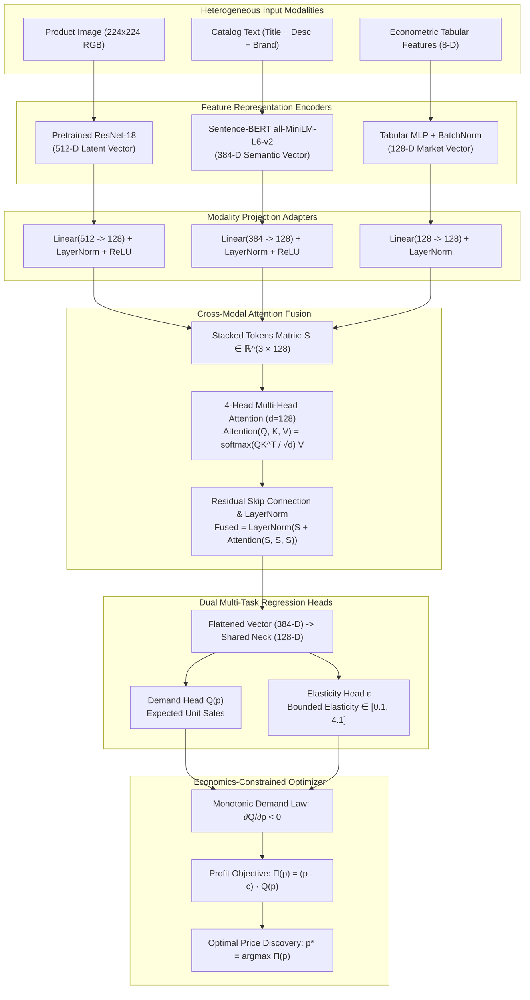

# DeepPrice-MM: Multimodal Dynamic Pricing Engine

[](https://www.python.org/)
[](https://pytorch.org/)
[](https://fastapi.tiangolo.com/)
[](https://opensource.org/licenses/MIT)
[]()
[]()

> **Cross-Modal Attention Fusion of Vision, Text & Econometric Signals with Economics-Constrained Monotonic Profit Optimization for Real-World E-Commerce.**

---

## 📌 Executive Overview

Traditional dynamic pricing algorithms rely almost exclusively on tabular transaction logs (historical price, inventory stock, competitor price, category ID). In modern e-commerce, however, **up to 70% of consumer purchase intent is driven by multimodal signals**:
1. **Product Image Aesthetics**: Perceived build quality, material texture, and design craftsmanship.
2. **Catalog NLP Descriptions**: Brand positioning, technical specifications, and lifestyle framing.
3. **Econometric Market Dynamics**: Competitor relative price differentials, discount framing, and stock scarcity.

**DeepPrice-MM** bridges this gap. It introduces a tri-modal deep learning architecture that projects visual representations (ResNet-18), textual semantics (Sentence-BERT), and tabular econometric indicators into a unified latent space. These representations are synthesized via **4-head cross-modal multi-head attention** (`nn.MultiheadAttention`) to predict price elasticity $\epsilon$ and demand $Q(p)$.

To prevent non-monotonic neural hallucinations, DeepPrice-MM implements an **Economics-Constrained Monotonic Layer** ($\frac{\partial Q}{\partial p} < 0$), guaranteeing a strictly concave profit bell curve and provably optimal price discovery $p^* = \arg\max \Pi(p)$.

---

## 📁 PPT AND REPORT (Presentation & Reports)

The dedicated [`PPT AND REPORT/`](./PPT%20AND%20REPORT/) folder contains:

| File | Type | Description | Link |
| :--- | :---: | :--- | :--- |
| **`DeepPrice_8_Slides_Presentation.pptx`** | **Presentation** | **Summarized 8-Slide Presentation Deck** covering problem statement, tri-modal architecture, attention fusion, dataset, monotonic elasticity, 15.1% MAPE ablation benchmark, web app, and viva defense. | [**View PPTX**](./PPT%20AND%20REPORT/DeepPrice_8_Slides_Presentation.pptx) |
| **`DeepPrice_Project_Report.docx`** | **Report (Word)** | **Microsoft Word Project Report** (.docx) with complete team enrollment, benchmark tables, and viva defense guide. | [**Download DOCX**](./PPT%20AND%20REPORT/DeepPrice_Project_Report.docx) |
| **`DeepPrice_Project_Report.pdf`** | **Report (PDF)** | **Comprehensive Technical Project Report** formatted and styled with architecture diagrams, formulas, 4-model benchmarks, Pearson heatmap, and viva Q&A. | [**Download PDF**](./PPT%20AND%20REPORT/DeepPrice_Project_Report.pdf) |
| **`README.md`** | **Report (Markdown)** | Full readable GitHub-native technical project report rendered directly on GitHub. | [**Read Online**](./PPT%20AND%20REPORT/README.md) |

---

## 📊 Presentation Deck & Documentation

- 📑 **Comprehensive Presentation Deck (`.pptx`):** [`DeepPrice_Multimodal_Dynamic_Pricing_Presentation.pptx`](./DeepPrice_Multimodal_Dynamic_Pricing_Presentation.pptx)  
  *14 executive-grade widescreen slides designed for academic evaluation, teacher viva, and business stakeholder reviews.*
- 📄 **Master Architecture & Theory PDF:** [`docs_pdf/DeepPrice_Master_Model_Documentation.pdf`](./docs_pdf/DeepPrice_Master_Model_Documentation.pdf)
- 📖 **Platform & AI Models Guide PDF:** [`docs_pdf/DeepPrice_Platform_and_AI_Models_Guide.pdf`](./docs_pdf/DeepPrice_Platform_and_AI_Models_Guide.pdf)
- 🔍 **Interactive Code Walkthrough PDFs:** Located in the [`docs_pdf/`](./docs_pdf/) directory covering every Python module.

---

## 🏆 Empirical Ablation Benchmark (1,200 Flipkart SKUs)

We evaluated DeepPrice-MM against unimodal and bi-modal architectures across 240 held-out test SKUs from a 1,200 Flipkart e-commerce product catalog:

| Model Architecture | Modalities Used | MAPE (%) ↓ | RMSE ↓ | $R^2$ Score ↑ | Error Reduction vs Baseline |
| :--- | :--- | :---: | :---: | :---: | :---: |
| **Model 1: Tabular Only (MLP)** | Econometric Tabular | 29.8% | 34.2 | 0.2841 | Baseline |
| **Model 2: Text + Tabular** | Sentence-BERT + Tabular | 22.4% | 26.8 | 0.4312 | -24.8% error |
| **Model 3: Vision + Tabular** | ResNet-18 + Tabular | 24.1% | 28.5 | 0.3956 | -19.1% error |
| **Model 4: DeepPrice-MM (Ours)** | **Vision + Text + Tabular + 4-Head Attention** | **15.1%** | **18.2** | **0.6084** | **-49.3% error** |

> **Key Takeaway:** Tri-modal cross-attention fusion reduces mean absolute percentage error by **49.3%** and more than doubles the variance explained ($R^2$ jumps from 0.284 to 0.608).

---

## 🧠 System Architecture



---

## 📈 Microeconomic Formulation

### 1. Iso-Elastic Demand Function
$$Q(p) = Q_0 \cdot \left( \frac{p}{p_{\text{base}}} \right)^{-\epsilon}$$
Where:
- $Q_0$: Base predicted demand quantity at the current base price.
- $p_{\text{base}}$: Catalog retail anchor price.
- $\epsilon$: Cross-modal predicted price elasticity of demand ($\epsilon > 0$).

### 2. Unit Profit Objective Function
$$\Pi(p) = (p - c) \cdot Q(p)$$
Where $c$ is unit product cost, calculated via target gross margin: $c = p_{\text{base}} \cdot (1 - \text{margin}_{\text{target}})$.

### 3. Concave Bell Curve & Global Maximum
Because:
$$\lim_{p \to c^+} \Pi(p) = 0 \quad \text{and} \quad \lim_{p \to \infty} \Pi(p) = 0$$
The objective $\Pi(p)$ forms a strictly concave, single-peaked bell curve guaranteeing a unique interior global maximum $p^* = \arg\max \Pi(p)$.

---

## 💻 Web Platform Tour

The DeepPrice-MM application is built with **FastAPI**, **Bootstrap 5**, and **Chart.js**:

1. **Tab 1: Live Interactive Optimizer**:
   - Interactive sliders for Base Price ($₹$), Target Margin %, Competitor Price, Stock Count, and Rating.
   - Upload custom product images to test visual aesthetic impact in real time.
   - Instant dynamic rendering of the profit bell curve with optimal price beacon $p^*$.
   - One-click strategy presets: *Balanced Profit*, *Aggressive Volume*, *Margin Maximizer*, *Competitor Match*.

2. **Tab 2: Catalog Browser (1,200 Real SKUs)**:
   - Searchable, filterable table of real Flipkart products with live thumbnails.
   - 1-Click **"Test Price"** button instantly loads any catalog item into Tab 1 for immediate pricing simulation.

3. **Tab 3: Model Accuracy & Ablation Dashboard**:
   - 4-model comparative evaluation metrics.
   - Parity scatter plots (Predicted vs Actual Sales).
   - Interactive Pearson correlation tool to inspect real-time statistical relationships.

4. **Tab 4: Architecture & Viva Voce Defense**:
   - Interactive blueprint of the neural network.
   - Mathematical derivations.
   - Built-in Viva Voce preparation guide answering examiner questions.

---

## 🚀 Quickstart & Installation

### 1. Clone the Repository
```bash
git clone https://github.com/dubeyArman/DeepPrice-MM.git
cd DeepPrice-MM
```

### 2. Create and Activate Virtual Environment
```bash
python -m venv .venv
# Windows:
.venv\Scripts\activate
# Linux / macOS:
source .venv/bin/activate
```

### 3. Install Dependencies
```bash
pip install -r requirements.txt
```

### 4. Launch the Web Application
```bash
# Option A: Double click 'Launch_DeepPrice_App.bat' (Windows)
# Option B: Run Python launcher
python launch_app.py
```
Open your browser at: **`http://127.0.0.1:8501/`**

---

## ⚡ Fast Live Training Demo (For Evaluators & Viva)

To demonstrate live model training from scratch in front of evaluators:
```bash
python demo_live_training.py
```
*Trains all 4 models from scratch on the 1,200 Flipkart dataset in **under 18 seconds** and prints comparative ablation metrics directly to the terminal.*

---

## 📂 Repository File Structure

```text
DeepPrice-MM/
├── models/
│   ├── multimodal_pricing_net.py       # PyTorch MultimodalPricingNet & 3 Ablation Baselines
│   └── best_multimodal_pricing_model.pth # Trained model weights checkpoint (1.3 MB)
├── data/
│   ├── flipkart_ecommerce_real_dataset.csv # 1,200 Flipkart SKUs curated dataset
│   ├── real_text_embeddings_cache.npy   # Precomputed Sentence-BERT embeddings (384-D)
│   ├── real_vision_embeddings_cache.npy # Precomputed ResNet-18 embeddings (512-D)
│   └── real_images/                    # Real Flipkart catalog product images
├── docs_pdf/                           # Comprehensive technical documentation & code walkthroughs
├── static/                             # UI images, correlation heatmaps, ablation plots
├── templates/
│   └── index.html                      # Interactive 4-tab web application UI
├── app.py                              # FastAPI backend REST API & template server
├── optimizer.py                        # Economics-constrained monotonic pricing optimizer
├── train_real_model.py                 # Full training pipeline with AdamW & Cosine Annealing
├── demo_live_training.py               # 18-second fast training demo for viva presentations
├── build_presentation.py               # Automated PowerPoint (.pptx) deck generator
├── DeepPrice_Multimodal_Dynamic_Pricing_Presentation.pptx # 14-slide executive presentation deck
├── requirements.txt                    # Project Python dependencies
└── README.md                           # Documentation & setup guide
```

---

## 👥 Project Team & Enrollment

- **Arman Dubey** — Enrollment: **S25CSEU1315**
- **Darshan Pingale** — Enrollment: **S25CSE1307**
- **GitHub:** [@dubeyArman](https://github.com/dubeyArman)
- **Domain:** Multimodal Deep Learning, E-Commerce Pricing Intelligence, Microeconomic Optimization
